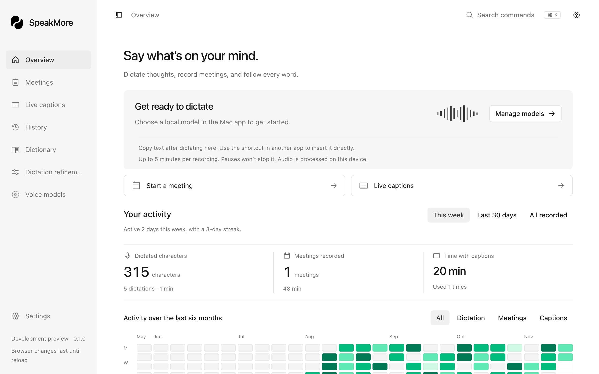

<div align="center">


# SpeakMore

**Private, on-device voice dictation for macOS.**<br/>
Hold a key, speak, and your words land in any app. No cloud required.

[](LICENSE)
[](#quick-start)
[](https://tauri.app)
[](https://www.rust-lang.org)
[](https://github.com/AIchovy/SpeakMore/stargazers)

**English** · [简体中文](README.zh-CN.md)



</div>

## Features

- **Dictate anywhere**: hold <kbd>Control</kbd> + <kbd>Option</kbd> + <kbd>Space</kbd>, speak, then release. The text goes into the app you're typing in.
- **Local speech recognition**: Whisper, SenseVoice, Parakeet and Qwen3-ASR run on your Mac. Audio never leaves the device.
- **Meetings**: record or import audio and get a transcript with speaker labels, decisions and action items. Send the results to Notion.
- **Live captions**: floating captions for system audio and the microphone, with optional translation.
- **AI polish (optional)**: clean up text with rules per app or website, using your own key for OpenAI, Anthropic, Ollama or any OpenAI-compatible API. Keys are stored in the macOS Keychain.
- **History and dictionary**: searchable history, TXT/CSV export and custom vocabulary.

## Quick start

Requirements: macOS 14+ on Apple Silicon, Xcode, Node.js 22.12+, Rust 1.91+ and CMake.

```bash
git clone https://github.com/AIchovy/SpeakMore.git
cd SpeakMore
npm ci
npm run desktop
```

Open **Settings → Local models**, download a model, then click **Use**.

| Command                 | Purpose                                                |
| ----------------------- | ------------------------------------------------------ |
| `npm run desktop`       | Run the desktop app in development mode                |
| `npm run desktop:build` | Build a local `.app` bundle (ad-hoc signed)            |
| `npm run dev`           | Preview the UI only in a browser at `127.0.0.1:1420`   |
| `npm run check`         | Type-check, build, and run the frontend and Rust tests |

## Models

All models are downloaded on demand and verified against a signed catalog. You can also import them offline.

| Model                  | Languages               | Size   |
| ---------------------- | ----------------------- | ------ |
| Whisper small          | Multilingual            | 191 MB |
| Whisper large-v3-turbo | Multilingual            | 575 MB |
| SenseVoice Small       | zh · en · ja · ko · yue | 242 MB |
| Parakeet TDT v3        | 25 European languages   | 673 MB |
| Qwen3-ASR 0.6B         | 30 languages            | 989 MB |

## Architecture

```
src/          React 19 + shadcn/ui interface
src-tauri/    Tauri 2 desktop shell, macOS integration
crates/       Rust core: audio, ASR workers, models, providers, storage
resources/    Signed model catalog, native helpers
docs/         Design notes and test evidence
```

Each speech engine runs in a separate worker process (built on [whisper.cpp](https://github.com/ggml-org/whisper.cpp) and [sherpa-onnx](https://github.com/k2-fsa/sherpa-onnx)). The worker is supervised by the app and talks to it over a private pipe, so a crashing model can't take the app down.

Read the [development guide](docs/development.md) for testing, native builds and diagnostics.

## Roadmap

- [x] macOS dictation, meetings and live captions
- [ ] Developer ID signing and auto-update
- [ ] Windows support

## Contributing

Issues and pull requests are welcome. Please run `npm run check` before opening a PR.

## License

[MIT](LICENSE). Model weights are downloaded separately and keep their own licenses: see [asr-models-NOTICE.txt](resources/asr-models-NOTICE.txt).
