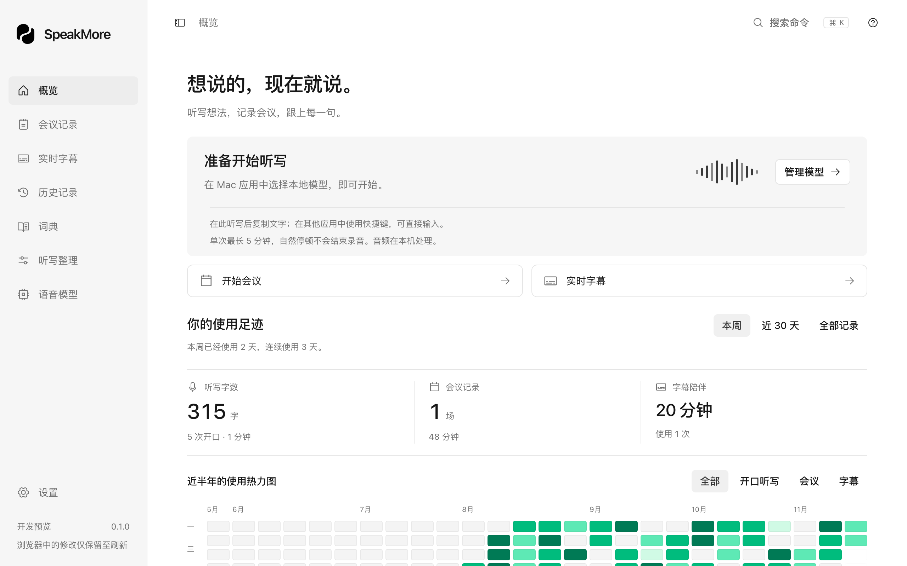

<div align="center">


# SpeakMore

**本地优先的 macOS 语音输入。**<br/>
按住快捷键说话，文字直接进入任意应用，无需联网。

[](LICENSE)
[](#快速开始)
[](https://tauri.app)
[](https://www.rust-lang.org)
[](https://github.com/AIchovy/SpeakMore/stargazers)

[English](README.md) · **简体中文**



</div>

## 功能

- **随处听写**：按住 <kbd>Control</kbd> + <kbd>Option</kbd> + <kbd>Space</kbd> 说话，松开后文字进入当前输入框。
- **本地识别**：Whisper、SenseVoice、Parakeet、Qwen3-ASR 在本机运行，音频不出设备。
- **会议记录**：录制或导入音频，生成带说话人标记的转写、决策和待办，可同步到 Notion。
- **实时字幕**：为系统声音和麦克风显示悬浮字幕，可开启翻译。
- **AI 整理（可选）**：按应用或网站设置整理规则。使用你自己的 OpenAI、Anthropic、Ollama 或 OpenAI 兼容接口，密钥保存在 macOS 钥匙串。
- **历史与词典**：历史可搜索，可导出 TXT/CSV，支持自定义词汇。

## 快速开始

环境：macOS 14+（Apple Silicon）、Xcode、Node.js 22.12+、Rust 1.91+、CMake。

```bash
git clone https://github.com/AIchovy/SpeakMore.git
cd SpeakMore
npm ci
npm run desktop
```

打开 **设置 → 本地模型**，下载模型后点击 **使用模型**。

| 命令                    | 用途                                   |
| ----------------------- | -------------------------------------- |
| `npm run desktop`       | 以开发模式运行桌面应用                 |
| `npm run desktop:build` | 构建本地 `.app`（ad-hoc 签名）         |
| `npm run dev`           | 只在浏览器预览界面：`127.0.0.1:1420`   |
| `npm run check`         | 类型检查、构建，并运行前端和 Rust 测试 |

## 模型

模型按需下载，并用签名目录校验，也支持离线导入。

| 模型                   | 语言                   | 大小   |
| ---------------------- | ---------------------- | ------ |
| Whisper small          | 多语言                 | 191 MB |
| Whisper large-v3-turbo | 多语言                 | 575 MB |
| SenseVoice Small       | 中 · 英 · 日 · 韩 · 粤 | 242 MB |
| Parakeet TDT v3        | 25 种欧洲语言          | 673 MB |
| Qwen3-ASR 0.6B         | 30 种语言              | 989 MB |

## 架构

```
src/          React 19 + shadcn/ui 界面
src-tauri/    Tauri 2 桌面壳与 macOS 集成
crates/       Rust 核心：音频、识别 worker、模型、AI 服务、存储
resources/    签名模型目录与原生辅助程序
docs/         设计说明与测试证据
```

每个识别引擎都在独立的 worker 进程中运行（基于 [whisper.cpp](https://github.com/ggml-org/whisper.cpp) 和 [sherpa-onnx](https://github.com/k2-fsa/sherpa-onnx)），由应用监管，并通过私有管道通信。模型崩溃不会拖垮应用。

测试、原生构建和诊断见 [开发指南](docs/development.md)。

## 路线图

- [x] macOS 听写、会议记录、实时字幕
- [ ] Developer ID 签名与自动更新
- [ ] Windows 支持

## 参与贡献

欢迎提交 Issue 和 PR。提交 PR 前请先运行 `npm run check`。

## 许可证

[MIT](LICENSE)。模型权重单独下载，并沿用各自的许可证，详见 [asr-models-NOTICE.txt](resources/asr-models-NOTICE.txt)。
